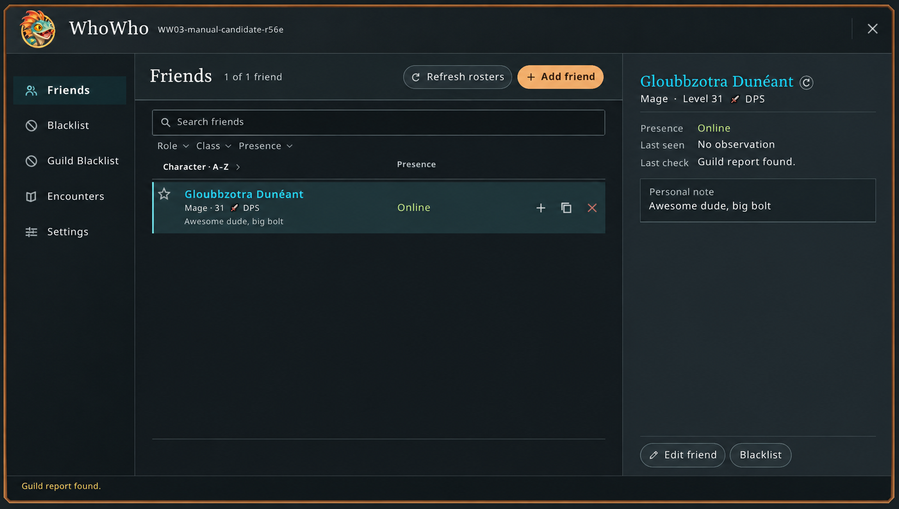
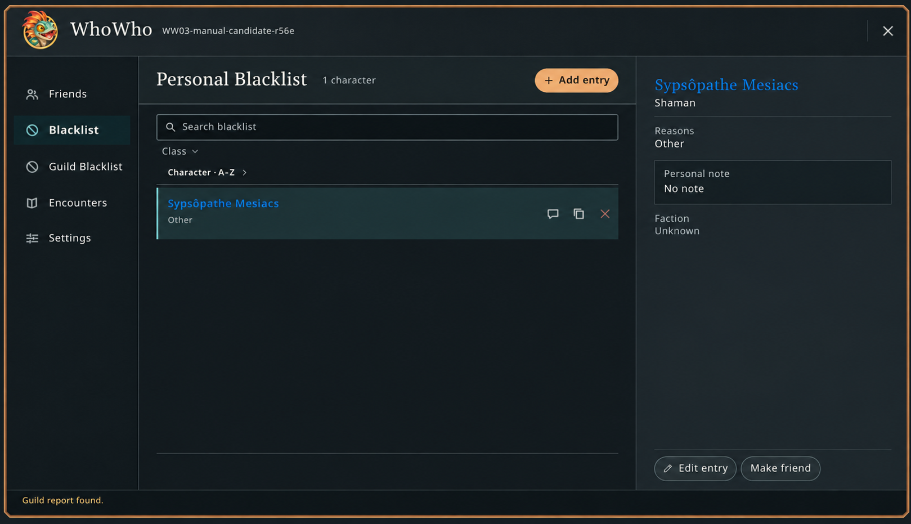
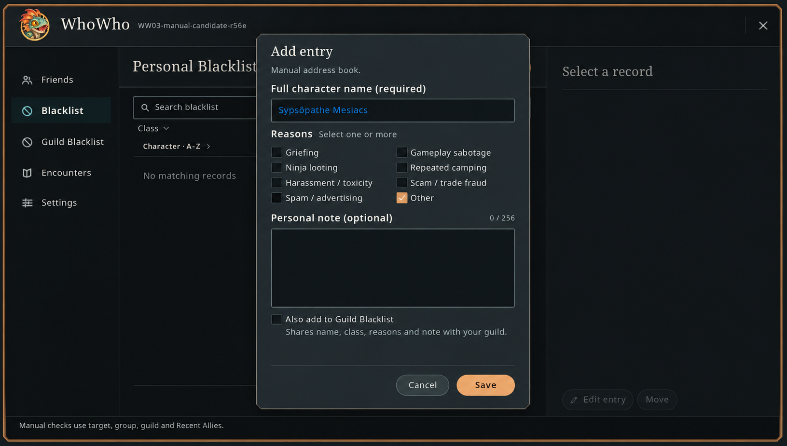
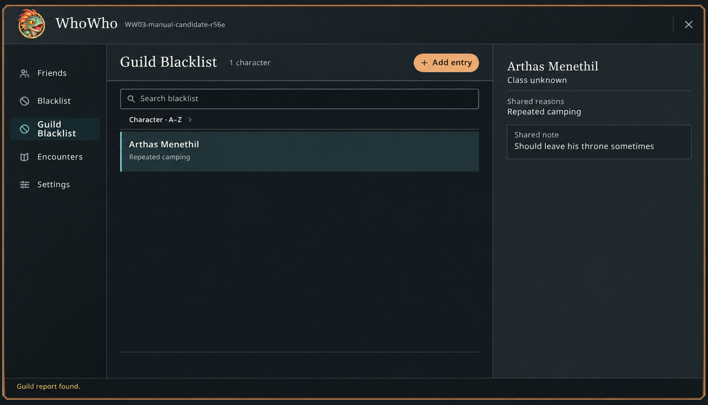
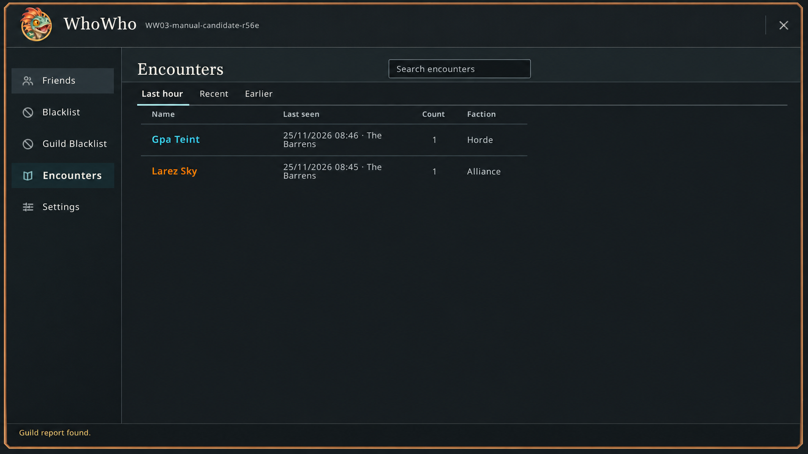
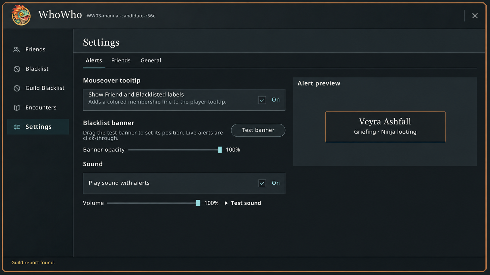

[English](README.md) · **Français**

Vous vous souvenez du tank qui a attiré toute la salle et sauvé le groupe quand même ? Et du voleur qui a passé la moitié de la soirée à camper votre cadavre ? Avec WhoWho, gardez une liste d’amis et une liste noire dans World of Warcraft: Forever. Vous pouvez prendre des notes, recevoir des alertes et retrouver vos rencontres.

## Installation

Téléchargez `WhoWho-*.zip` depuis les [versions publiées sur GitHub](https://github.com/bedhev-spec/whowho-addon-official/releases). Fermez le jeu, puis extrayez le dossier `WhoWho` dans `Interface/AddOns`. Lancez Forever et ouvrez WhoWho avec le bouton de la minicarte ou la commande `/wwpreview`.

## Amis, listes noires et rencontres

Retrouvez les joueurs avec qui vous avez aimé jouer dans **Amis**. Vous pouvez les mettre en favoris, noter comment vous les avez rencontrés et voir quand vous les avez croisés pour la dernière fois.

Quand vous ajoutez quelqu’un à votre **Liste noire personnelle**, choisissez un ou plusieurs motifs. La prochaine fois que WhoWho repère ce joueur, la bannière affiche son nom et les motifs. Si plusieurs joueurs de la liste apparaissent en même temps, la bannière indique `+N de plus`. Faites un Ctrl-clic sur la bannière pour ouvrir la rencontre, ou retrouvez-la plus tard dans **Rencontres**.

La **Liste noire de guilde** permet de partager les entrées de votre choix avec les membres de votre guilde qui utilisent WhoWho.

Tout membre de la guilde disposant d’une version à jour de WhoWho peut supprimer une entrée de la liste noire de guilde, et la suppression vaut pour toute la guilde. WhoWho demande toujours une confirmation. Les autres membres sont mis à jour quand ils se synchronisent avec un membre qui a la suppression, mais les anciennes versions de WhoWho conservent l’entrée. Seul un nouvel ajout depuis la page **Liste noire de guilde** la rétablit ; partager une entrée de votre liste noire personnelle ne le fait pas.

Quand votre personnage quitte une guilde, WhoWho efface la liste noire de guilde enregistrée pour celle-ci, y compris l’historique des suppressions, sauf si un autre de vos personnages la conserve. Rejoindre une autre guilde en jeu l’efface aussitôt. Sinon, cela prend environ une minute, ou se produit la prochaine fois que vous jouez ce personnage. Seules les guildes où ce personnage a été vu avec cette version sont concernées. Un autre de vos personnages ne conserve la liste que si vous l’avez joué dans cette guilde avec cette version, assez longtemps pour que WhoWho le repère alors que la liste de la guilde était enregistrée. Un personnage que vous n’avez pas joué depuis la mise à jour, comme un personnage banque, ne compte pas. Les membres de la guilde ne sont pas affectés.

WhoWho enregistre au plus 32 listes de guilde. Quand une nouvelle guilde a besoin de place, il efface une liste qu’aucun de vos personnages repérés ne conserve, y compris l’historique des suppressions, en commençant par celle qui a le moins d’entrées. Si toutes les listes sont conservées, WhoWho ne peut pas enregistrer de liste pour la nouvelle guilde.

### Ajout rapide

Faites un clic droit sur le nom d’un personnage dans un message de discussion pris en charge, ou sur son cadre de cible, de focalisation, de groupe ou de raid. Choisissez **Ajouter à WhoWho**, puis **Amis** ou **Liste noire**. Le menu apparaît quand Forever fournit assez d’informations pour identifier le personnage.

Vous pouvez aussi cibler un joueur et cliquer sur **Ajouter** dans la liste noire personnelle pour remplir son nom. Pour saisir un nom à la main, cliquez sur **Ajouter un ami** dans Amis ou sur **Ajouter** dans l’une des listes noires. Saisissez le nom tel qu’il s’affiche, avec les deux parties si elles sont visibles.

## Personnalisation

Choisissez Par défaut, Ardoise cyan, Bleu portuaire, Vert mousse, Beige, Graphite ou Terre d’ombre dans **Paramètres → Général**. Dans **Alertes**, vous pouvez régler l’opacité de la bannière et le volume du son. Cliquez sur **Tester la bannière**, puis faites glisser l’aperçu à l’endroit où vous souhaitez afficher les alertes.

## Captures d’écran

Les captures montrent l’interface en anglais.

### Listes noires personnelle et de guilde

### Rencontres

### Paramètres

## Questions fréquentes

### Quand WhoWho peut-il repérer un joueur ?

WhoWho peut repérer les joueurs que vous ciblez ou survolez avec la souris. Il vérifie aussi automatiquement si des joueurs sur liste noire figurent dans votre groupe ou votre raid quand sa composition change. Pour qu’il lise aussi les barres de nom que Forever rend accessibles, activez **Utiliser les barres de nom visibles des joueurs** dans **Paramètres → Général → Rencontres dans le monde**.

Pour chaque bannière, WhoWho consulte d’abord votre **liste noire personnelle**. S’il n’y trouve pas le joueur, il consulte la **liste noire** de votre guilde actuelle.

Pour un ami déjà ajouté, **Vérifier l’état** peut aussi le retrouver dans votre groupe ou raid actuel.

### WhoWho peut-il trouver des joueurs de la faction adverse ?

Vous pouvez ajouter des joueurs des deux factions. WhoWho peut repérer un joueur adverse à proximité si Forever lui donne accès aux informations du personnage. La recherche **Who** se limite à votre faction. L’absence de résultat pour un joueur de la faction adverse ne permet donc pas de savoir s’il est en ligne.

### Combien de temps durent les alertes et quand peuvent-elles se répéter ?

La bannière reste visible pendant 8 secondes avant de s’estomper. Après une alerte, WhoWho attend au moins 30 secondes avant de vous alerter à nouveau pour le même joueur. Quand vous ajoutez un joueur à votre liste noire personnelle, le délai est de 5 minutes pour ce joueur. Une fois le délai écoulé, WhoWho peut vous alerter s’il repère à nouveau ce joueur lors d’une nouvelle rencontre. Une exception : si un joueur de votre liste noire rejoint votre groupe ou votre raid pendant un délai, WhoWho vous alerte quand même, au maximum une fois toutes les 30 secondes par joueur.

### Les alertes fonctionnent-elles en donjon ou en raid ?

Les alertes de liste noire sont désactivées dans les donjons et les raids instanciés, y compris la bannière et le son. Vous pouvez toujours tester la bannière dans les paramètres.

### Est-ce que je retrouve mes listes sur mes autres personnages ?

Oui. Vos amis et les entrées de votre liste noire personnelle sont partagés entre les personnages du même compte et de la même région.

### Ma guilde peut-elle voir ma note personnelle ?

Si vous partagez une entrée de votre liste noire personnelle avec votre guilde, la note est partagée avec elle. Vous pouvez laisser la note vide quand vous ajoutez une entrée directement à la liste noire de guilde.

## Retours

Pour signaler un bug ou proposer une amélioration, ouvrez un ticket dans les [issues GitHub](https://github.com/bedhev-spec/whowho-addon-official/issues).
