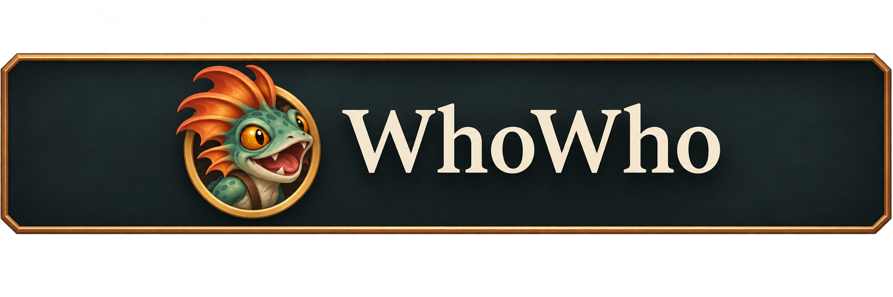
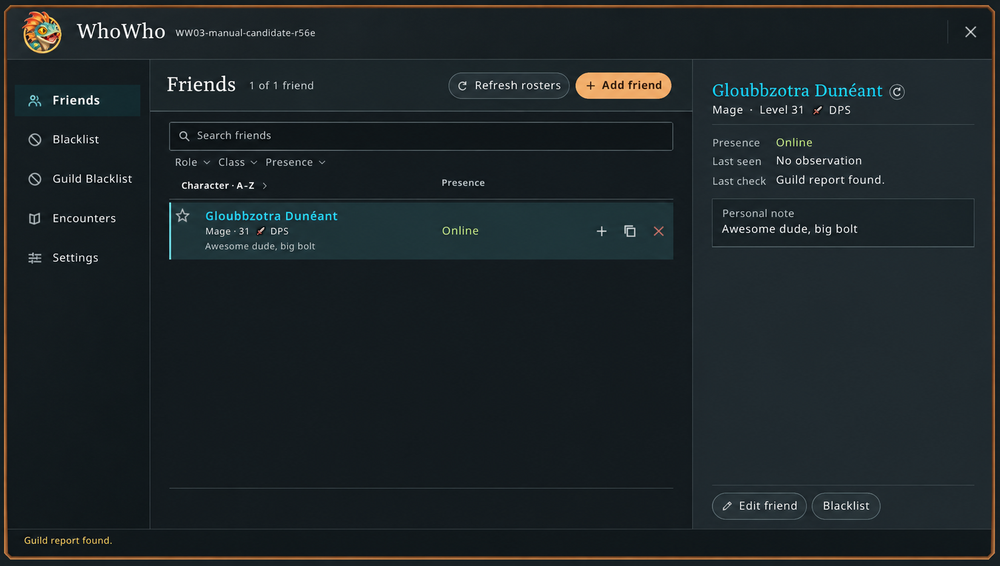
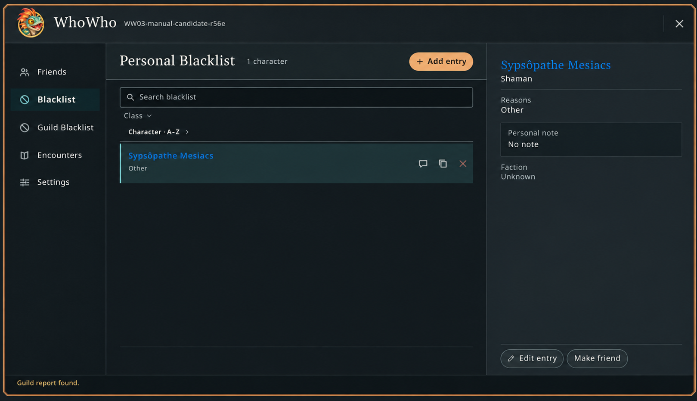
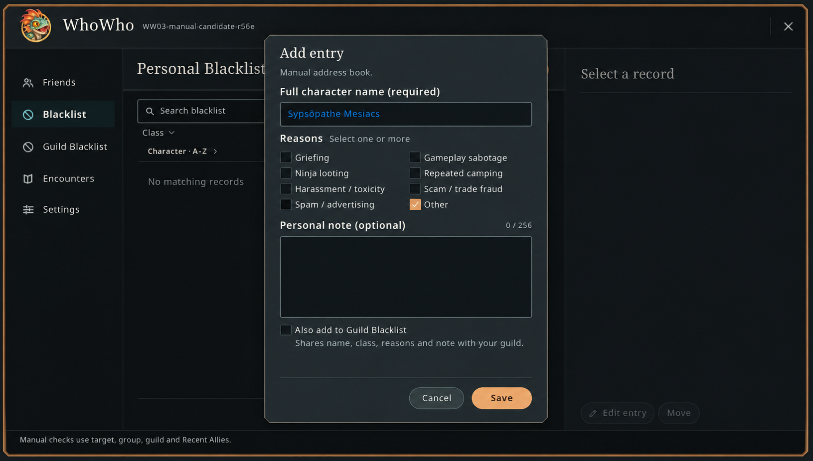
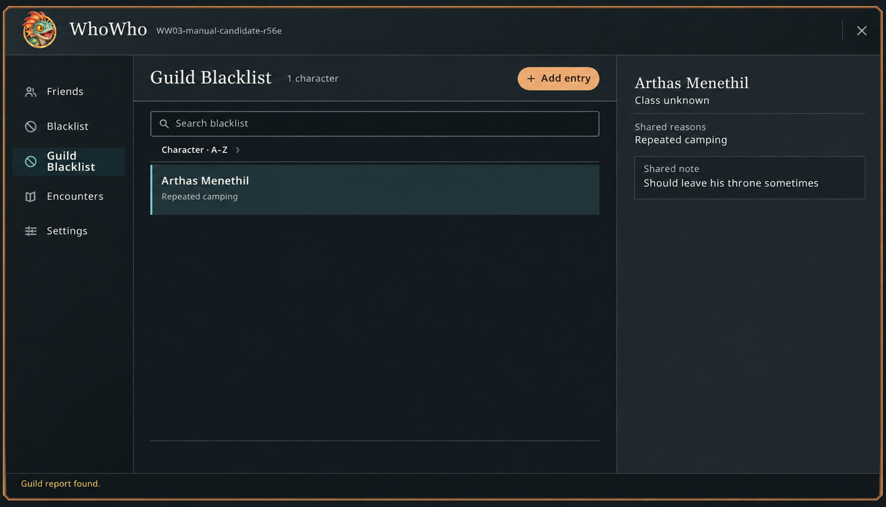
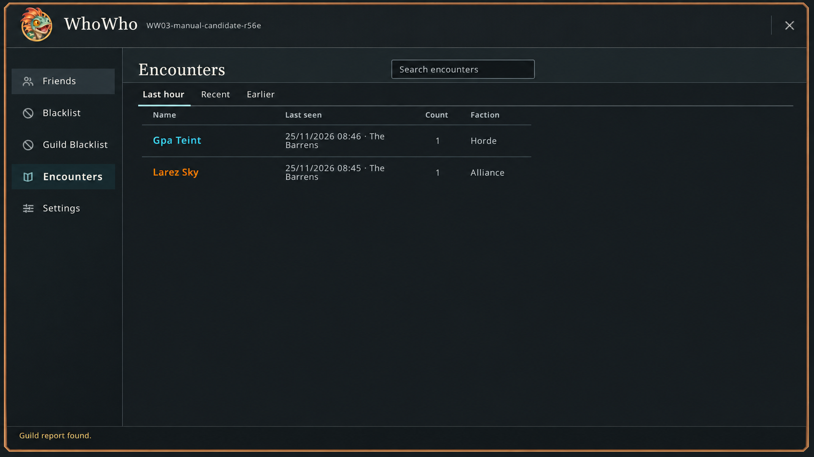
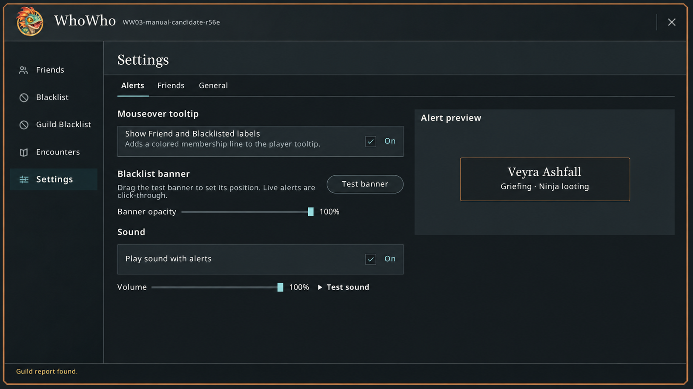

**English** · [Français](README.fr.md)

Remember the tank who pulled the whole room and somehow saved the run? How about the rogue who spent half the evening camping your corpse? WhoWho keeps a personal Friends list and Blacklist for World of Warcraft: Forever, with notes, live alerts, and a record of your run-ins.

## Install

Download `WhoWho-*.zip` from [GitHub Releases](../../releases). With the game closed, extract the `WhoWho` folder into `Interface/AddOns`. Launch Forever and open WhoWho from the minimap button or type `/wwpreview`.

## Friends, blacklists, and run-ins

Give good company a star in **Friends**. Save a note about how you met and check when you last saw them.

If someone earns a spot on your **Personal Blacklist**, pick one or more reasons. The next time WhoWho spots them, the banner shows their name and reasons. If several names from your list turn up together, it adds a `+N more` count. Ctrl-click the banner to open the encounter, or look it up later in **Encounters**.

Use the **Guild Blacklist** to share selected entries with guildmates who use WhoWho.

Any guild member with an up-to-date WhoWho can delete a Guild Blacklist entry, and the deletion applies to the whole guild. WhoWho always asks you to confirm it. Guildmates catch up when they sync with a member who has the deletion, while older versions of WhoWho keep the entry. Only adding the player again on the **Guild Blacklist** page brings it back; sharing a Personal Blacklist entry does not.

When your character leaves a guild, WhoWho erases the Guild Blacklist saved for it, including its deletion history, unless another of your characters keeps it. Joining another guild while playing erases it at once. Otherwise it takes about a minute, or happens the next time you play that character. Only guilds that character was seen in with this version are covered. Another of your characters keeps the list only if you have played it in that guild with this version, long enough for WhoWho to notice it while the guild's list was saved. A character you have not played since upgrading, such as a bank alt, does not count. Guildmates are not affected.

WhoWho saves at most 32 guild lists. When a new guild needs room, it erases one list that none of your recorded characters keeps, including its deletion history, starting with the one with the fewest entries. If every list is kept, WhoWho cannot save a list for the new guild.

### Quick Add

Right-click a character's name in supported chat messages, or right-click their target, focus, party, or raid frame. Choose **WhoWho Add**, then **Friends** or **Blacklist**. The menu appears when Forever gives WhoWho enough information to identify the character.

You can also target a player and click **Add entry** in **Personal Blacklist** to fill in their name. To enter a name yourself, use **Add friend** in Friends or **Add entry** in either Blacklist. Type the name as it appears, including both parts when shown.

## Make it yours

Choose Default, Cyan Slate, Harbor Blue, Moss Green, Beige, Graphite, or Umber under **Settings → General**. Under **Alerts**, you can adjust banner opacity and sound volume. Click **Test banner**, then drag the preview where you want alerts to appear.

## Screenshots

### Personal and Guild Blacklists

### Encounters

### Settings

## FAQ

### When can WhoWho spot a player?

WhoWho can spot players you target or mouse over. It also checks for blacklist matches automatically when your party or raid roster changes. Turn on **Use visible player nameplates** under **Settings → General → World sightings** to also use the nameplates that Forever makes readable.

For each banner, WhoWho checks your **Personal Blacklist** first. If there is no personal match, it checks the **Guild Blacklist** for your current guild.

For a saved Friend, **Check status** can also look for them in your current party or raid.

### Can WhoWho find players from the other faction?

You can add players from either faction. WhoWho can spot an opposing player nearby when Forever makes their character information available. **Who** lookups are limited to your own faction, so a failed lookup for someone from the other faction doesn't tell you whether they're online.

### How long do blacklist alerts last, and when can they repeat?

The banner stays visible for 8 seconds before fading. After an alert, WhoWho waits at least 30 seconds before alerting on the same player again. Adding a player to your Personal Blacklist starts a 5-minute cooldown for that player. Once the cooldown ends, WhoWho can alert you the next time it spots them in a new encounter. One exception: if a blacklisted player joins your group or raid during a cooldown, WhoWho alerts you anyway, at most once every 30 seconds per player.

### Do blacklist alerts work in dungeons or raids?

Live blacklist alerts, including the banner and its sound, are disabled inside dungeons and raid instances. **Test banner** is still available in Settings.

### Do my lists follow me to my other characters?

Yes. Your Friends and Personal Blacklist entries are shared across characters on the same account and in the same region.

### Will my guild see my personal note?

If you share a Personal Blacklist entry with your guild, its note goes with it. You can leave the note blank when adding an entry directly to the Guild Blacklist.

## Feedback

Report bugs or suggest improvements in [GitHub Issues](https://github.com/bedhev-spec/whowho-addon-official/issues).
